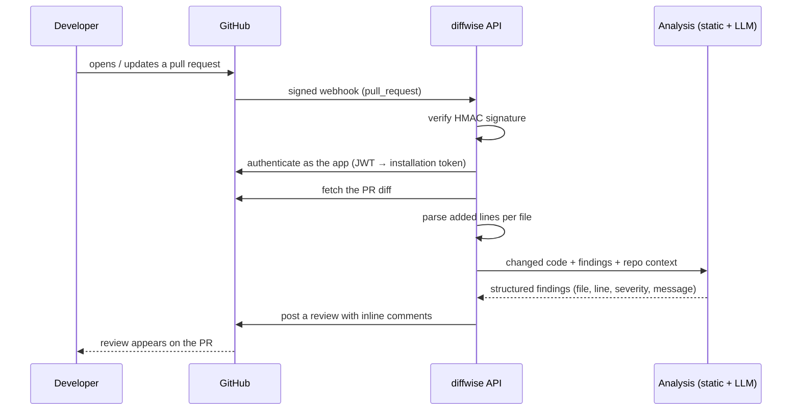

# diffwise

**An AI-assisted pull request reviewer, built as a GitHub App.**
diffwise reads what changed in a pull request, runs static analysis on it, and (soon) asks an LLM, with context retrieved from the repository's own code, to explain and prioritize the findings. It then posts the result as inline review comments on the exact lines that need attention.

> **Status: work in progress.** The GitHub integration (signed webhooks, app authentication, fetching and parsing diffs) works today. Static analysis, AI review and posting comments are being built next. See the [roadmap](#roadmap).

---

## How it works



1. **Webhook:** GitHub notifies diffwise when a pull request is opened or updated. Every request is verified with an HMAC-SHA256 signature before anything else happens.
2. **Authentication:** diffwise signs a short-lived JWT with the app's private key and exchanges it for an installation token that expires after an hour and only works on the repositories where the app is installed.
3. **Diff:** it downloads the pull request's unified diff and extracts each file's added lines with their new line numbers, the only lines GitHub accepts review comments on.
4. **Analysis** *(in progress)*: static analysis (Ruff, Bandit, Semgrep) produces deterministic findings; an LLM explains and prioritizes them using related code retrieved from the repository (RAG). Output is validated, structured JSON, never free text.
5. **Review** *(in progress)*: findings are de-duplicated and posted as a single pull request review with inline comments.

It's designed to run on a **zero budget**: the AI engine is pluggable (`AI_PROVIDER`), and with `none` diffwise still produces useful static-analysis-only reviews.

## Roadmap

| Phase | Scope | Status |
|---|---|---|
| **1. First working review** | Webhooks, app auth, diff parsing, static analysis, pluggable AI engine, inline review comments | 🔄 In progress |
| **2. Production backend** | PostgreSQL + Redis worker queue, idempotent processing, Docker Compose, CI quality gates | ⏳ Planned |
| **3. Repository-aware reviews** | tree-sitter code chunking, embeddings in pgvector, retrieval; an evaluation set measuring precision/recall | ⏳ Planned |
| **4. Dashboard** | Next.js dashboard with GitHub login: reviews, findings by category, repository health over time | ⏳ Planned |

**Done so far in Phase 1:**
- [x] FastAPI service with a health endpoint and typed, validated settings
- [x] `POST /webhooks/github` with signature verification and request size limits
- [x] GitHub App authentication (RS256 JWT → installation access token)
- [x] Fetching pull request diffs and parsing added lines (renames, deletions, binary files, multi-hunk changes)
- [ ] Static analysis on changed files
- [ ] Pluggable AI engine (`none` / `fake` / `github`) with structured JSON output
- [ ] Posting reviews with inline comments

## Security design

Security is built in from the first endpoint, not added later:

- **Webhook signatures:** every webhook is verified with HMAC-SHA256 using a shared secret, compared in constant time (`hmac.compare_digest`) to prevent timing attacks. Failures return one generic `401`, so attackers learn nothing about why.
- **Request limits:** webhook bodies are read in chunks and rejected with `413` past 25 MB (GitHub's maximum), so oversized requests can't exhaust memory.
- **Least privilege:** the app only requests *Contents: read* and *Pull requests: read & write*. Installation tokens expire after one hour and are scoped to the repositories the app is installed on.
- **Secrets handling:** secrets are loaded from the environment and typed as `SecretStr`, so they're masked if printed or logged. The private key file lives outside the repository; only its path is configured. Errors never include tokens or response bodies.
- **Input validation:** settings are validated at startup (fail fast), and values from webhooks are validated before being used in API URLs (no path traversal).
- **Supply chain:** dependencies are pinned with checksums in `uv.lock`; pre-commit hooks block committed private keys; Ruff's security rules (Bandit) run on every commit.

## Testing

Tests are first-class: every change ships with them.

- **No network in tests:** GitHub is mocked with [respx](https://lundberg.github.io/respx/), and crypto tests use throwaway RSA keys generated per run.
- **Real fixtures:** test data comes from reality: a webhook payload and a diff captured from GitHub, plus diffs produced by `git` for each edge case.
- **Test design, not just coverage:** boundary values (e.g. secret length 31/32, body size at/over the limit), equivalence classes, negative cases (tampered bodies, wrong keys, path traversal), and checks that errors never leak credentials.
- **Tests that can fail:** verification logic was mutation-checked by hand (deliberately breaking the code to confirm the tests catch it).
- **Live contract checks:** the mocked behaviour is confirmed against the real GitHub API with a test installation.

```bash
uv run pytest
```

## Running locally

**Requirements:** Python 3.13+ and [uv](https://docs.astral.sh/uv/).

```bash
git clone https://github.com/hamzajasar/diffwise.git
cd diffwise
uv sync                          # install dependencies from uv.lock
uv run pre-commit install        # enable the commit hooks
cp .env.example .env             # then fill in the values (see below)
uv run fastapi dev backend/app/main.py
```

The API runs at `http://localhost:8000`; interactive docs are at `/docs`, and `GET /health` returns `{"status": "ok"}`.

### Connecting a GitHub App

1. [Register a GitHub App](https://github.com/settings/apps/new) with **Contents: read-only** and **Pull requests: read & write** permissions, subscribed to the **Pull request** event.
2. Generate a webhook secret (`python -c "import secrets; print(secrets.token_hex(32))"`) and set it both in the app settings and as `GITHUB_WEBHOOK_SECRET` in `.env`.
3. Set `GITHUB_APP_ID`, and generate a private key. Store it **outside the repository** (e.g. `~/.config/diffwise/`, permissions `600`) and point `GITHUB_PRIVATE_KEY_PATH` at it.
4. For local development, forward webhooks with [smee.io](https://smee.io):
   ```bash
   npx smee-client --url https://smee.io/<your-channel> --target http://localhost:8000/webhooks/github
   ```
5. Install the app on a test repository and open a pull request.

All settings are documented in [`.env.example`](.env.example).

## Tech stack

| Area | Choice |
|---|---|
| API | Python 3.13, FastAPI, Pydantic v2, pydantic-settings |
| GitHub | GitHub App, webhooks, PyJWT (RS256), httpx |
| Diffs | unidiff |
| Static analysis *(planned)* | Ruff, Bandit, Semgrep |
| AI *(planned)* | pluggable provider (GitHub Models free tier), validated JSON output |
| Data *(planned)* | PostgreSQL + pgvector, SQLAlchemy 2.0, Alembic, Redis + arq |
| Testing | pytest, respx, real captured fixtures; Playwright and k6 planned |
| Tooling | uv, Ruff, pre-commit; GitHub Actions planned |

## Project structure

```
backend/
├── app/
│   ├── main.py          # FastAPI app and routes
│   ├── config.py        # typed settings from the environment
│   ├── github/          # webhooks, signature verification, app auth, API calls
│   └── review/          # diff parsing (static analysis and AI review next)
└── tests/               # mirrors app/; fixtures/ holds real captured data
```

## Contributing

The `dev` branch is the default and integration branch; `main` holds releases. Changes go through pull requests into `dev` with [Conventional Commits](https://www.conventionalcommits.org/) and tests in the same PR.
