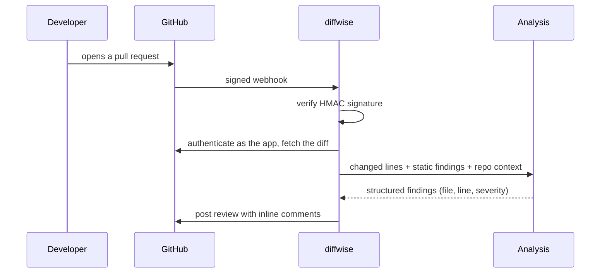

# diffwise

**An AI-assisted pull request reviewer, built as a GitHub App.**
It reads what changed in a pull request, runs static analysis, and uses an LLM with context from the repository's own code to post review comments on the exact lines that need attention.

> **Status: work in progress.** The GitHub integration works today: signed webhooks, app authentication, and fetching and parsing diffs. Analysis and posting reviews come next.

## How it works



The AI engine is pluggable (`AI_PROVIDER`). With `none`, diffwise still posts static-analysis-only reviews, so it runs at zero cost.

## Roadmap

- [x] Webhook endpoint with signature verification
- [x] GitHub App authentication (JWT → short-lived installation token)
- [x] Fetch and parse pull request diffs
- [ ] Static analysis on changed files (Ruff, Bandit, Semgrep)
- [ ] Pluggable AI engine with validated JSON output
- [ ] Post reviews with inline comments
- [ ] Background worker, PostgreSQL, Docker Compose, CI
- [ ] Repository-aware reviews (RAG with pgvector) + an evaluation set
- [ ] Dashboard (Next.js)

## Security

- **Verified webhooks:** HMAC-SHA256 signatures, compared in constant time; one generic `401` for every failure.
- **Bounded input:** request bodies over 25 MB are rejected while streaming; webhook values are validated before use in API URLs.
- **Least privilege:** the app can only read code and write pull request reviews; its tokens expire after one hour and work only on installed repositories.
- **Secrets stay secret:** typed as `SecretStr` (masked in logs), never included in errors; the private key lives outside the repository.

## Testing

- **No network in tests:** GitHub is mocked with respx; crypto tests use throwaway keys.
- **Real fixtures:** webhook payloads and diffs captured from GitHub and `git`, one per edge case.
- **Test design:** boundary values, equivalence classes and negative cases; security checks were mutation-tested by hand.

```bash
uv run pytest
```

## Run locally

Requires Python 3.13+ and [uv](https://docs.astral.sh/uv/).

```bash
git clone https://github.com/hamzajasar/diffwise.git && cd diffwise
uv sync
cp .env.example .env   # fill in the values; each key is documented there
uv run fastapi dev backend/app/main.py
```

To receive real webhooks, [register a GitHub App](https://github.com/settings/apps/new) (Contents: read, Pull requests: read & write, event: Pull request) and forward webhooks locally with [smee.io](https://smee.io).

## Tech stack

Python 3.13 · FastAPI · Pydantic v2 · httpx · PyJWT · unidiff · pytest · respx · uv · Ruff · pre-commit
